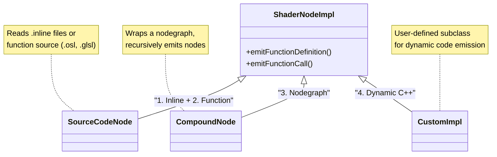
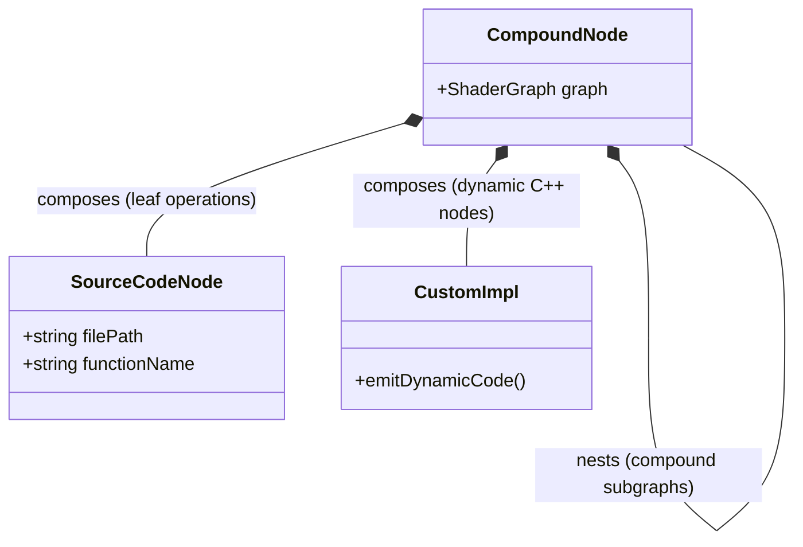
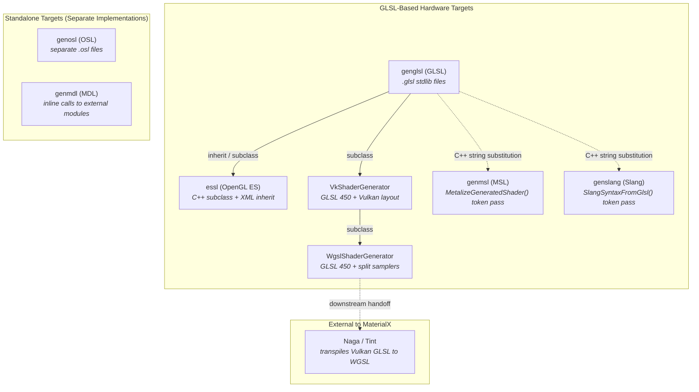

# metashade.mtlx

This package integrates Metashade with [MaterialX](https://github.com/AcademySoftwareFoundation/MaterialX). It aims to extend MaterialX's nodegraph-centric codegen and provide the following benefits:
* a single-source mechanism for implementing source code nodes for diverse target languages;
* flexible control flow, impossible or hard to express in node graphs;
* metaprogramming, enabling optimization among other things.

## MaterialX architecture recap

In MaterialX, **node definitions**, represented by the `NodeDef` C++ class and serialized as `<nodedef>` XML elements, define the interface of nodes of a given type from the perspective of node graphs and visual editors (category names, input/output port names, types, and default values).

The actual codegen implementations for the node definitions are defined in separate **node implementation** objects:
* in the document model, serialized as either `<implementation>` (class `Implementation`) or `<nodegraph>` (class `NodeGraph`).
* in codegen, implemented by C++ classes derived from `ShaderNodeImpl`.

Crucially, **Implementations reference NodeDefs, not the other way around**, which makes it possible to override implementations without modifying upstream node definitions.

### MaterialX Node Implementation Code Generation mechanisms

A MaterialX node implementation uses one of the [four different codegen approaches](https://github.com/AcademySoftwareFoundation/MaterialX/blob/main/documents/DeveloperGuide/ShaderGeneration.md#13-node-implementations) to generate target code:

1. **Inline Expression** — a simple inline expression specified directly in the node definition. This is used for straightforward operations that can be expressed in a single line (e.g., `{{in1}} + {{in2}}` for an add node). The expression uses the target shading language syntax with input port references wrapped in double curly brackets.

2. **Shading Language Function** — The node is implemented as a function written in the target language, with the source code stored in a separate file. The function signature matches the nodedef's interface of typed inputs and outputs.

3. **Nodegraph Implementation** — The node is implemented as a nodegraph composed of other nodes.

4. **Dynamic Code Generation (C++)** — A C++ class derived from `ShaderNodeImpl` handles the implementation, emitting code programmatically during shader generation. Used when static source code isn't sufficient — for example, when code needs to be customized based on node parameters, or when vertex streams and uniforms need to be created dynamically.

### Key Implementation Classes

The following diagram shows how the above four methods map to `ShaderNodeImpl` subclasses:

### Composition of Node Implementation Types

The different MaterialX node implementation types can be composited in the following ways:

* `CompoundNode` (`<nodegraph nodedef="...">`) encapsulates an internal `ShaderGraph`. It can recursively contain and instantiate other `CompoundNode`s as well as leaf `SourceCodeNode`s and `CustomImpl` nodes.

* `SourceCodeNode` (`<implementation file="..." function="...">`) instances are **strictly leaves in the shader DAG**: they have no internal `ShaderGraph` and cannot wrap other nodes.

### Portability of Source Code Nodes across Target Languages

While nodegraph implementations (`CompoundNode`) are target-agnostic and programmatically generate code for any target language, source code nodes (`SourceCodeNode`) are written directly in a specific shading language. As of MaterialX 1.39.5, there is no single-source mechanism for them; instead, targets either reuse the GLSL implementation files via inheritance and ad-hoc string substitution, or maintain separate implementations from scratch:

* **GLSL dialects (`genglsl`, `essl`, `VkShaderGenerator`, `WgslShaderGenerator`)**: Share the `.glsl` standard library directly. `EsslShaderGenerator` and `VkShaderGenerator` subclass `GlslShaderGenerator` to adjust version directives, precision qualifiers, and resource bindings. `WgslShaderGenerator` is a small subclass of `VkShaderGenerator` that emits Vulkan GLSL 450 with split texture and sampler parameters (`texture2D` + `sampler`), leaving actual transpilation to WGSL to external tools such as Naga or Tint.
* **String-substituted targets (`genmsl`, `genslang`)**: Inherit from `genglsl` in XML (`<targetdef inherit="genglsl" />`) and point directly to its `.glsl` files. After emitting the shader stages, `MslShaderGenerator::MetalizeGeneratedShader()` and `SlangShaderGenerator::SlangSyntaxFromGlsl()` run C++ string-replacement passes over the generated code to rewrite parameter qualifiers (`out`/`inout` to `thread Type &`), vector/matrix types, and intrinsics (`mix` to `lerp`, `dFdx` to `dfdx`/`ddx`). Because this transformation is ad-hoc, nodes that use unsupported constructs must either be worked around in the token table or reimplemented in the target language.
* **Standalone targets (`genosl`, `genmdl`)**: Diverge too much syntactically from GLSL for string substitution, so source code nodes must be implemented separately—as dedicated `.osl` files for `OslShaderGenerator`, or as inline calls to external `materialx::stdlib` modules for `MdlShaderGenerator`.

---

## How Metashade Integrates

Metashade integrates with MaterialX primarily at the source code implementation level, with support for companion nodegraph wiring and design-time specialization:

### 1. Leaf Level: Source Code Nodes

Authoring complex shading models directly as handwritten GLSL files is error-prone, while expressing them as pure XML nodegraphs can quickly become unwieldy.

Metashade allows authoring leaf node logic in Python and compiling it into target source code (such as GLSL) along with the corresponding MaterialX `<implementation>`. For example, `metashade_standard_surface_bsdf` implements the multi-lobe evaluation of standard surface in Python.

### 2. Source Code Node Acquisition (`acquire_function`)

To avoid reimplementing standard library functions, Metashade provides a reflection mechanism:

`acquire_function()` inspects upstream MaterialX `NodeDef` and `Implementation` declarations and exposes them as callable Python functions. For example, it can acquire `ND_oren_nayar_diffuse_bsdf` and `ND_dielectric_bsdf`, translating typed arguments, `ClosureData`, and `inout` parameters so they can be invoked directly from Metashade code, while automatically tracking required `#include` headers.

### 3. Re-implementing Standard Surface

To integrate with existing pipelines, the generated BSDF implementation can override the stock standard surface definition:

1. Metashade generates the leaf BSDF source code node (`metashade_standard_surface_bsdf`).
2. A companion compound `<nodegraph>` (`NG_metashade_standard_surface`) exposes the `ND_standard_surface_surfaceshader` interface, instantiates the leaf BSDF node, and connects its output to `ND_surface`.

Because MaterialX implementations reference NodeDefs, this cleanly overrides the stock implementation without modifying definitions.

### 4. Design-Time Permutations (Lobe Pruning)

Metashade supports generating specialized shader variants at design time via the `Permutation` configuration:
* For variants with disabled lobes (such as `subsurface=False`), dead code branches and acquired function calls are stripped from the generated source code.
* Unused inputs (such as subsurface parameters) are omitted from the node definition and nodegraph, and unneeded `#include` headers are dropped.

This reduces shader code size and avoids unnecessary GPU resource usage.

### 5. Single-Source Multi-Target Authoring

By authoring node logic in Python, Metashade provides the missing single-source mechanism for leaf implementations. Instead of maintaining separate GLSL and OSL codebases or relying on fragile string search-and-replace passes, developers can express shader math once in Python and compile clean, idiomatic target code for diverse backends.

