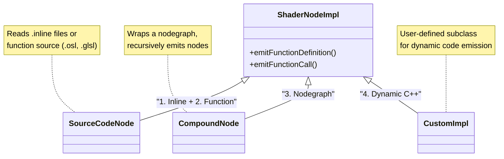
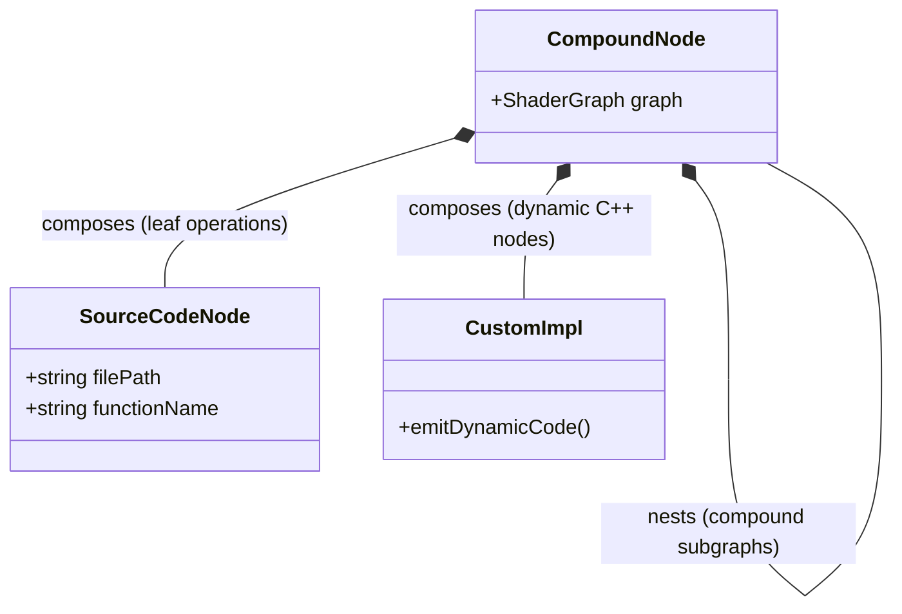
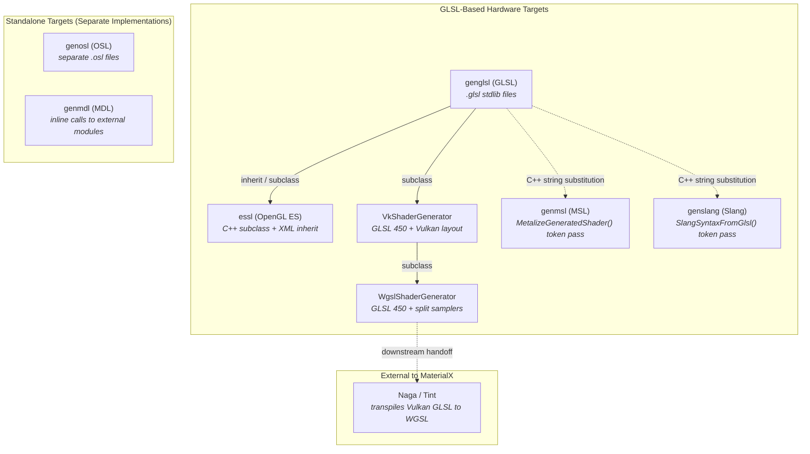

# metashade.mtlx

This package integrates Metashade with [MaterialX](https://github.com/AcademySoftwareFoundation/MaterialX). It aims to extend MaterialX's nodegraph-centric codegen and provide the following benefits:
* a single-source mechanism for implementing source code nodes for diverse target languages;
* flexible control flow, impossible or hard to express in node graphs;
* metaprogramming, enabling optimization among other things.

## MaterialX architecture recap

In MaterialX, **node definitions**, represented by the `NodeDef` C++ class and serialized as `<nodedef>` XML elements, define the interface of nodes of a given type from the perspective of node graphs and visual editors (category names, input/output port names, types, and default values).

The actual codegen implementations for the node definitions are defined in separate **node implementation** objects:
* in the document model, serialized as either `<implementation>` (class `Implementation`) or `<nodegraph>` (class `NodeGraph`).
* in codegen, implemented by C++ classes derived from `ShaderNodeImpl`.

Crucially, **Implementations reference NodeDefs, not the other way around**, which makes it possible to override implementations without modifying upstream node definitions.

### MaterialX Node Implementation Code Generation mechanisms

A MaterialX node implementation uses one of the [four different codegen approaches](https://github.com/AcademySoftwareFoundation/MaterialX/blob/main/documents/DeveloperGuide/ShaderGeneration.md#13-node-implementations) to generate target code:

1. **Inline Expression** — a simple inline expression specified directly in the node definition. This is used for straightforward operations that can be expressed in a single line (e.g., `{{in1}} + {{in2}}` for an add node). The expression uses the target shading language syntax with input port references wrapped in double curly brackets.

2. **Shading Language Function** — The node is implemented as a function written in the target language, with the source code stored in a separate file. The function signature matches the nodedef's interface of typed inputs and outputs.

3. **Nodegraph Implementation** — The node is implemented as a nodegraph composed of other nodes.

4. **Dynamic Code Generation (C++)** — A C++ class derived from `ShaderNodeImpl` handles the implementation, emitting code programmatically during shader generation. Used when static source code isn't sufficient — for example, when code needs to be customized based on node parameters, or when vertex streams and uniforms need to be created dynamically.

### Key Implementation Classes

The following diagram shows how the above four methods map to `ShaderNodeImpl` subclasses:

### Composition of Node Implementation Types

The different MaterialX node implementation types can be composited in the following ways:

* `CompoundNode` (`<nodegraph nodedef="...">`) encapsulates an internal `ShaderGraph`. It can recursively contain and instantiate other `CompoundNode`s as well as leaf `SourceCodeNode`s and `CustomImpl` nodes.

* `SourceCodeNode` (`<implementation file="..." function="...">`) instances are **strictly leaves in the shader DAG**: they have no internal `ShaderGraph` and cannot wrap other nodes.

### Portability of Source Code Nodes across Target Languages

While nodegraph implementations (`CompoundNode`) are target-agnostic and programmatically generate code for any target language, source code nodes (`SourceCodeNode`) are written directly in a specific shading language. As of MaterialX 1.39.5, there is no single-source mechanism for them; instead, targets either reuse the GLSL implementation files via inheritance and ad-hoc string substitution, or maintain separate implementations from scratch:

* **GLSL dialects (`genglsl`, `essl`, `VkShaderGenerator`, `WgslShaderGenerator`)**: Share the `.glsl` standard library directly. `EsslShaderGenerator` and `VkShaderGenerator` subclass `GlslShaderGenerator` to adjust version directives, precision qualifiers, and resource bindings. `WgslShaderGenerator` is a small subclass of `VkShaderGenerator` that emits Vulkan GLSL 450 with split texture and sampler parameters (`texture2D` + `sampler`), leaving actual transpilation to WGSL to external tools such as Naga or Tint.
* **String-substituted targets (`genmsl`, `genslang`)**: Inherit from `genglsl` in XML (`<targetdef inherit="genglsl" />`) and point directly to its `.glsl` files. After emitting the shader stages, `MslShaderGenerator::MetalizeGeneratedShader()` and `SlangShaderGenerator::SlangSyntaxFromGlsl()` run C++ string-replacement passes over the generated code to rewrite parameter qualifiers (`out`/`inout` to `thread Type &`), vector/matrix types, and intrinsics (`mix` to `lerp`, `dFdx` to `dfdx`/`ddx`). Because this transformation is ad-hoc, nodes that use unsupported constructs must either be worked around in the token table or reimplemented in the target language.
* **Standalone targets (`genosl`, `genmdl`)**: Diverge too much syntactically from GLSL for string substitution, so source code nodes must be implemented separately—as dedicated `.osl` files for `OslShaderGenerator`, or as inline calls to external `materialx::stdlib` modules for `MdlShaderGenerator`.

---

## How Metashade Integrates

`metashade.mtlx` generates MaterialX source code nodes (`SourceCodeNode`) and companion nodegraphs (`CompoundNode`) from Python shader definitions. Currently, it targets `genglsl` and provides a re-implementation of Standard Surface (`standard_surface.py`) with design-time lobe pruning. The same approach can be applied to other surface shading models in MaterialX, such as glTF PBR (`gltf_pbr`) and OpenPBR (`open_pbr_surface`).

### 1. Reflecting Upstream Source Code Nodes (`acquire_function`)

Because a `SourceCodeNode` is a leaf in the MaterialX shader DAG, it cannot contain an internal `ShaderGraph`, though its generated source code can call other standard library functions directly.

To reuse existing MaterialX `stdlib` and `pbrlib` implementations without re-implementing them, `acquire_function()` (`mtlx_reflection.py`) inspects upstream MaterialX `<nodedef>` and `<implementation>` elements and exposes their underlying GLSL functions as typed Python callables on the Metashade context. It maps MaterialX data types (`dtypes.py`), injects the synthetic `ClosureData` parameter required by `pbrlib` BSDFs, handles `out`/`inout` outputs, and emits the corresponding `#include` directives.

### 2. Re-implementing Standard Surface (Overriding Standard Implementations)

In the stock MaterialX library, `ND_standard_surface_surfaceshader` is implemented as a `<nodegraph>` (`NG_standard_surface_surfaceshader_100`) that wires individual `pbrlib` BSDF and math nodes into the `surface` constructor.

`metashade.mtlx.standard_surface` replaces this graph using a two-layer implementation:
1. **BSDF source code node (`metashade_standard_surface_bsdf`)**: A Metashade-generated GLSL function (`mx_metashade_standard_surface_bsdf`) that receives `ClosureData` and calls acquired `pbrlib` functions (`mx_oren_nayar_diffuse_bsdf`, `mx_dielectric_bsdf`, `mx_conductor_bsdf`, `mx_sheen_bsdf`, `mx_translucent_bsdf`, `mx_subsurface_bsdf`, `mx_roughness_anisotropy`, `mx_artistic_ior`, `mx_layer_bsdf`, and `mx_mix_bsdf`).
2. **Surface shader nodegraph (`NG_metashade_standard_surface`)**: A thin `<nodegraph>` that wires the BSDF node together with emission (`uniform_edf`) and opacity into the `surface` constructor.

For the full (unpruned) shader, `NG_metashade_standard_surface` points directly to the standard `ND_standard_surface_surfaceshader` NodeDef. Loading the generated library overrides the stock `<nodegraph>` implementation in place, so existing materials continue to work without modification.

### 3. Lobe Pruning (Specialized NodeDefs and Graph Rewriting)

When specializing a shader by removing unused parameters, overriding the standard NodeDef in place is no longer sufficient because each specialized variant has a reduced input interface and multiple variants must be able to coexist in the same scene or library.

`standard_surface.py` defines five optional feature bundles (`LOBES`: `subsurface`, `sheen`, `transmission`, `metalness`, and `coat`), yielding $2^5 = 32$ `Permutation` variants parameterized by `LobeFlags`:
* **Specialized `<nodedef>`s and codegen**: While the full permutation overrides `ND_standard_surface_surfaceshader`, each of the 31 pruned permutations introduces a new `surfaceshader` `<nodedef>` (suffixed with its active lobes, e.g. `standard_surface_metalness_coat`) along with its own `<nodegraph>` and BSDF `<implementation>`. Disabled lobes have their code paths, unused input parameters, and unreferenced `pbrlib` `#include` directives stripped.
* **Rewriting materials and wrapper nodegraphs (`prune_material`, `prune_library`)**: To route existing assets to these new NodeDefs:
  * `prune_material(aswf_lib_doc, material_doc)` inspects top-level `standard_surface` nodes in a material document, determines which lobe gate inputs are statically zero or unconnected, rewrites each node's category to the matching pruned NodeDef, and strips unused inputs.
  * `prune_library(aswf_lib_doc, inout_lib_doc)` performs the same rewrite on `standard_surface` child nodes encapsulated inside wrapper nodegraphs in a library document (such as `adsk:opaque` or `adsk:metal`).

